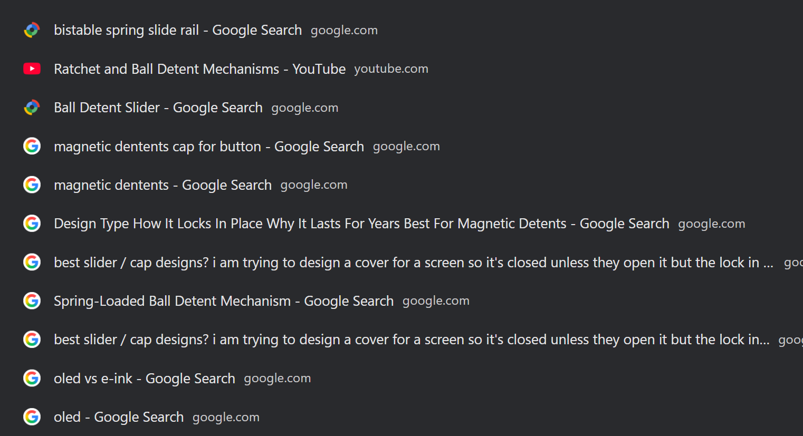
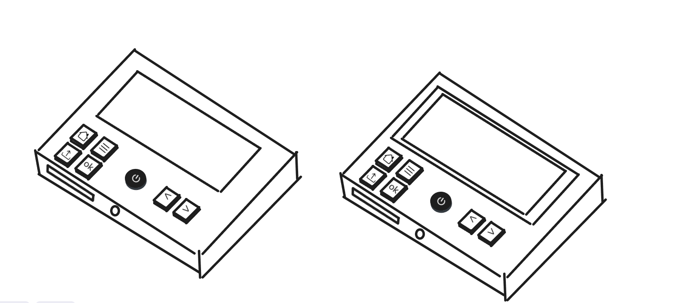
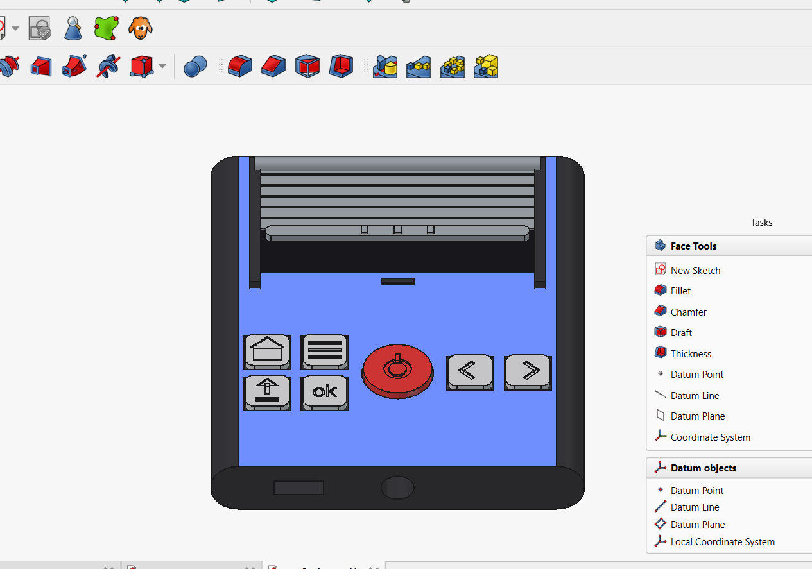

# October 2: Looking up inspiration and research

Watched videos of similar build, went through sample CAD designs, types of knobes and locks (there were many no screw locks that looked so cool but sounded tough). Got a rough idea of what to do first. 
A friend who was helping me get into this stuff said how it's really important that I go through what could fail test before I build or order stuff.
Apparently it's really easy to build the whole thing and only then realise oh shit missed an obvious feature and whole thing become unusable.

**Total time spent: 2 hours**

# October 5: Exaclidraw diagram and visual design

I was working on this other design (I am yet to update on, I just realised) when I found both of them share a lot in common. I could borrow button diagrams and svg's from that project when sketching in exaclidraw.
So was faster.
Chose round button for power alone so it's easier to differentiate
Both power buttons are together to the right
Other buttons are to the left

I am thinking if I should emboss them maybe because printing on the buttons fade so fast. But not sure how enudrable or costly that is.

**Total time spent: 1 hour**

# October 7: Finally installed FREECAD and started figuring it out.

I installed Autodesk Fusion but it was too heavy but also intimidating, so tried FREECad instead. I couldn't fully understand how to make those beautiful designs like shared in slack, but with python and the app,
I finally imported the same exaclidraw diagram itself as an svg. This made me understand a lot of concepts the tutorials were tryna say, nowhere near polished but atleast made me understand how to get things around and by the end I was able to make nice shapes (tho yeah not as polished if at all0

# October 9: EVERYONE!! did it

I was trying since yesterday to get comofortable with more shapes and it was really easy to fit together (tho it took me to take screenshot like multi dozen of times to find where each thing is)
I am still not sure of how things go inside just as well and I saw Raspberry Pi's are really hard to find in India, so not about the internal parts or internal cuts yet, but externally I am really proud of myself with this SEE. 
Maybe if I get used to the shortcuts and so, it will get really fast over time.

**Total time spent: 6 hour**
